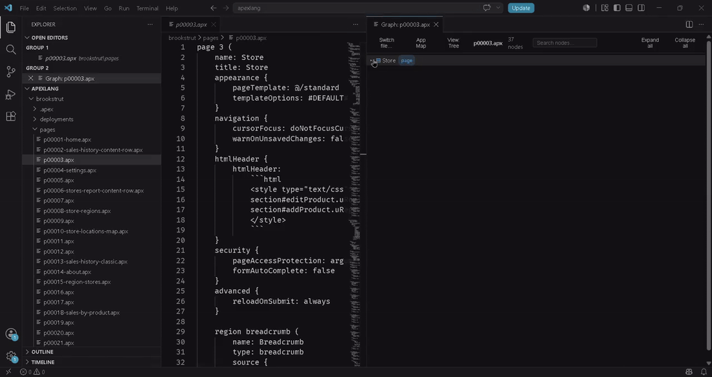

# APEXLang View

View Oracle APEX `.apx` (APEXLang) files as a collapsible component tree in VS Code — no APEX install required.



## Features

- **Outline tree** — page → regions → items → processes, rendered like VS Code's own Explorer. Click a node for its properties, breadcrumb, and a jump to that line in source.
- **Search** — filter by type, identifier, label, or property value.
- **Cross-references** — resolves `@identifier` links between components (References / Referenced by).
- **Cross-page navigation** — buttons, branches, and dynamic actions that redirect to another page show a `→ Page N` badge; click to switch.
- **By Type view** — flat grouping by component type, for scanning composition instead of hierarchy.
- **Graph view** — the same tree as a pannable node-graph canvas.
- **App Map** — a page-to-page navigation map across the whole app.
- **Diff vs HEAD** — highlights nodes added, changed, or removed since your last commit.
- **Live refresh** — the tree updates as you edit the file.
- Fully theme-aware (light/dark/custom).

## Usage

1. Open a `.apx` file.
2. Run **APEXLang View: Open Graph View** from the command palette, editor title bar, or file right-click.
3. Use **Switch File** to change which `.apx` file the view targets.

## Commands

| Command | Shortcut | Description |
|---|---|---|
| `APEXLang View: Open Graph View` | `Ctrl+Alt+L` (`Cmd+Alt+L` on Mac) | Opens/toggles the view for the active file |
| `APEXLang View: Switch File` | — | Quick-pick a different `.apx` file |
| `APEXLang View: Open App Map` | — | Shows the page-to-page navigation map for the whole app |
| `APEXLang View: Toggle Diff vs HEAD` | — | Highlights nodes changed since your last commit |
| `APEXLang View: Show Logs` | — | Output channel for parse timing and errors |

## Development

```bash
npm test          # regression suite (node:test)
```

Press `F5` to launch an Extension Development Host, then open a file from `fixtures/`.

Validated against a corpus of 1200+ real APEX exports.
