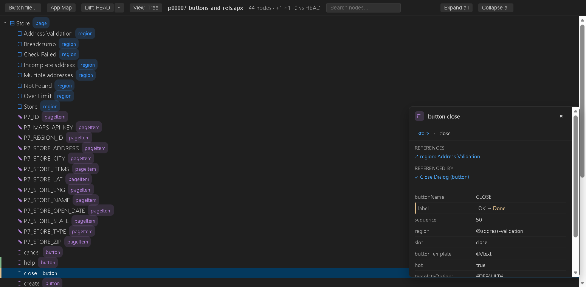

# APEXLang View

See an Oracle APEX `.apx` page as a tree in VS Code, so you don't have to scroll through thousands of lines of APEXlang to find one button.

[Install from the VS Code Marketplace](https://marketplace.visualstudio.com/items?itemName=MohammadSawalhah.apexlang-view)

## How to use it

Open any `.apx` file and press `Alt+Shift+L` (`Cmd+Alt+L` on Mac), or run **APEXLang View: Open Graph View**.

You get the page as a tree of regions, items, buttons, dynamic actions and processes. Click a row to see its properties, what it points to and what points to it, and to jump to its line in the file. The tree updates while you type. You don't need an APEX install or a database.

You can also:

- search by name, type or property value
- group the page by component type, or see it as a graph
- open the App Map to see which page links to which across the whole app
- turn on **Diff** to mark what changed since your last commit (yellow is changed, green is new), with old and new values in the details panel. The ▾ next to it compares with an older commit.

## Privacy

The extension sends anonymous usage counts and crash reports: which commands you use, and error types with line numbers in this extension's own code. It never sends file names, paths, `.apx` content or anything from git. It follows VS Code's telemetry setting, and you can switch it off for this extension alone with `apexlangView.telemetry.enabled`. Everything it can send is listed in [telemetry.json](telemetry.json).

## Feedback

If a page shows up wrong, [open an issue](https://github.com/Sawalhah/apexlang-view/issues) and paste the part of the `.apx` file that breaks it (with anything private removed).
